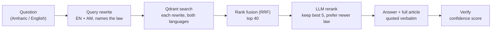

<div align="center">


<!-- Animated Typing Header -->
[](https://git.io/typing-svg)

<p>
  <a href="https://hirealijaan.com"></a>
  <a href="https://www.linkedin.com/in/engr-ali-jaan-manzoor/"></a>
  <a href="mailto:ranaalijaanmanzoor@gmail.com"></a>
  
</p>

</div>

---

### 👨‍💻 About Me

```typescript
const aliJaan = {
  role:        "Full Stack Engineer",
  location:    "Lahore, Pakistan 🇵🇰",
  experience:  "5+ years",
  focus:       ["Production RAG & LLM systems", "Scalable SaaS platforms", "API & system architecture"],
  currentWork: "Platforms + AI assistants @ Bright Techno Tonic",
  shipping:    ["Rumi AI (legal RAG)", "20K+ learner e-learning platform", "R2-backed course media"],
  principle:   "Know where it breaks under real load before it does.",
};
```

- 🧠 Building **Rumi AI**, a bilingual (Amharic / English) **RAG legal assistant** that cites the exact law and article for every answer
- 🎓 Scaled an **e-learning platform to 20,000+ active learners** with live classes, payments and progress tracking
- ☁️ Built a **course-media pipeline on Cloudflare R2 + CDN** for fast, low-cost video and document delivery
- 🛠 I own the whole path: **architecture → build → release → production scale**
- 💬 Ask me about **RAG, vector search, Node.js, NestJS, Angular, Next.js, FastAPI or system design**

---

### 🛠 Tech Stack

#### Frontend


#### Backend


#### AI & RAG


#### Databases & Queues


#### Cloud, DevOps & Payments


---

### 🧠 Under the Hood — Rumi AI (bilingual legal RAG)



- 📄 **Ingestion:** clean PDF text, Tesseract OCR for scanned and legacy-font Amharic, split bilingual gazettes into two languages
- ✂️ **Chunking by article** ("Article 7", "አንቀጽ ፯"), each chunk carrying its whole article so answers quote it in full
- 📊 **Eval benchmark** gates every release: accuracy, retrieval hit rate, per-stage latency and token cost
- ♻️ Same stack powers the **e-TutorsCity** and **Exam City AI** assistants

---

### ⚙️ A Snippet I Reach For — Hybrid Retrieval with Rank Fusion (Qdrant)

```python
from qdrant_client import QdrantClient, models

client = QdrantClient(url=QDRANT_URL, api_key=QDRANT_API_KEY)

def search(queries: list[str], limit: int = 40):
    """Search every rewrite of the question, then fuse the rankings.
    Lets an Amharic question find an English-only law, and vice versa."""
    vectors = embed(queries)  # one embedding per rewrite
    return client.query_points(
        collection_name="rumi_legal_documents",
        prefetch=[models.Prefetch(query=v, limit=limit) for v in vectors],
        query=models.FusionQuery(fusion=models.Fusion.RRF),  # reciprocal rank fusion
        limit=limit,
        with_payload=True,
    ).points
```

> One query per rewrite, fused server-side: no single phrasing decides what gets found,
> and the reranker only ever sees the strongest 40 passages.

---

### 🚀 Featured Projects

| Project | What it is | Stack | Live |
|--------|-------------|-------|------|
| **Rumi AI** | Bilingual legal RAG assistant for Ethiopian law, citing exact articles with a confidence score | FastAPI · Qdrant · OpenAI | Part of E-LawyerCity |
| **E-TutorsCity** | Tutoring marketplace with time-zone-safe scheduling, AI matching and payment-backed bookings | MEAN Stack | [Live ↗](https://e-tutorscity.com/) |
| **E-LawyerCity** | Ethiopia's first virtual legal office: lawyer discovery, video consults, case-scoped records | MEAN Stack | [Live ↗](https://e-lawyerscity.com/) |
| **AgileBrains** | Recruitment & ATS platform split into independently scaling microservices | Microservices | [Live ↗](https://agilebrains.com/) |

---

### 🏆 Selected Impact

| | |
|---|---|
| 🏗 **10+ production systems** | owned end to end, from architecture to go-live |
| 📈 **20,000+ active learners** | on an e-learning platform with live classes and progress tracking |
| 💳 **4 payment gateways** | Stripe, PayPal, Chapa, TeleBirr: USD 10K+/month at **99.9% uptime**, zero critical failures |
| ⚡ **40% lower API latency** | caching and query redesign |
| 🗄 **60% faster data layer** | targeted MongoDB index strategy |
| 🔐 **85% fewer unauthorized access attempts** | OAuth 2.0 / JWT overhaul |
| 🔎 **50% faster data fetching** | REST + GraphQL APIs handling 3,000+ monthly orders |
| 👥 **Led 10 developers** | shipping 5 products to production |
| 🤖 **Computer vision tools** | BirdWatch (YOLOv5, 77%) and a pneumonia detector (CNN, 84%) |

---

### 📊 GitHub Stats

<div align="center">
  
  
  <br/>
  
</div>

---

<div align="center">
  <i>Open to senior Full Stack and AI engineering roles: platforms, RAG and LLM systems.</i><br/><br/>
  <a href="https://hirealijaan.com"><b>hirealijaan.com</b></a>


</div>
